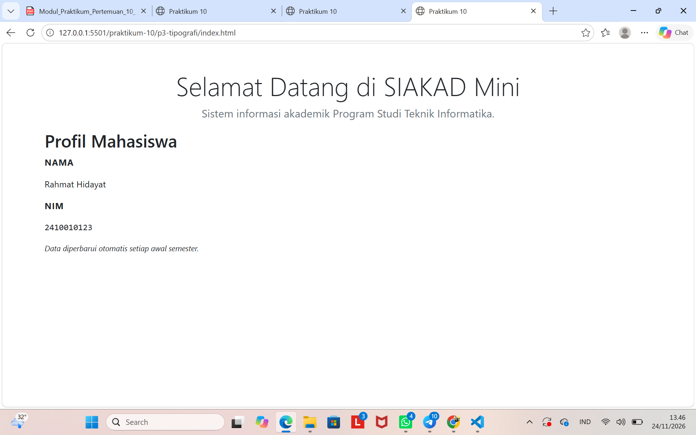

# Laporan Praktikum Pertemuan 10 — Pemrograman Web 1 
 
Nama  : Seftiana Noormah Darani
NIM   : 2510010119 
Kelas : 3B REG TI BJB
 
## Percobaan 1 — Navbar Lab 
|No | Eksperimen                                                  | Pengamatan                                                                       |
|---|-------------------------------------------------------------|----------------------------------------------------------------------------------|
|1  | Class #menuLab dan aria-expanded saat menu terbuka          | Menu berubah menjadi collapse show dan aria-expanded menjadi true.               |
|2  | Hamburger di 1000 px dengan navbar-expand-lg                | Hamburger tidak muncul karena menu sudah tampil mendatar.                        |   
|3  | Perilaku di 800 px: -md / tanpa sufiks / tanpa class expand | -md tampil mendatar, tanpa sufiks selalu mendatar, tanpa expand selalu terlipat. |
|4  | data-bs-target salah ketik                                  | Menu tidak terbuka karena target tidak sesuai dengan ID.                         |
|5  | Tanpa JS bundle                                             | Hamburger dan dropdown tidak berfungsi.                                          |
|6  | bg-dark tanpa dan dengan data-bs-theme="dark"               | Tanpa tema gelap teks sulit dibaca, dengan tema gelap teks menjadi terang.       |
|7  | sticky-top vs fixed-top                                     | sticky-top menempel saat digulir, fixed-top dapat menutupi judul.                |
 
## Percobaan 2 — Buttons & Badges 
|No | Eksperimen                                              | Pengamatan                                                                                  |
|---|---------------------------------------------------------|---------------------------------------------------------------------------------------------|
|1  | Kelompok Batal–Simpan di 375 px dan 1000 px             | Pada 375 px tombol bertumpuk, sedangkan 1000 px tombol berjajar dan rata kanan.             |
|2  | Elemen nonaktif yang masih bisa difokus dengan Tab      | Button disabled dilewati, tetapi link yang hanya memakai class disabled masih bisa difokus. |
|3  | Kontras text-bg-warning vs bg-warning                   | text-bg-warning lebih mudah dibaca karena teksnya berwarna gelap.                           |
|4  | Nama tombol Notifikasi dengan dan tanpa visually-hidden | Dengan visually-hidden, pembaca layar mendapat keterangan jumlah notifikasi.                |
 
## Percobaan 3 — Tipografi 
|Class lama    | Utilitas pengganti (isi)             | Tampilan sama? (ya/tidak) |
|--------------|--------------------------------------|---------------------------|
|.judul-besar  | display-5 text-center                | Ya                        |
|.pembuka      | lead text-body-secondary text-center | Ya                        |
|.label        | text-uppercase fw-bold small         | Hampir sama               |
|.catatan      | small fst-italic                     | Ya                        |
|.nim          | font-monospace                       | Ya                        |
  
 
## Jawaban Pertanyaan Analisis 
1. Apa yang dilakukan JavaScript Bootstrap terhadap DOM saat hamburger diklik?
    JavaScript Bootstrap mengubah isi DOM dengan menambahkan atau menghapus class "show" pada menu. Nilai "aria-expanded" juga berubah menjadi "true" saat menu dibuka dan "false" saat ditutup.

2. Mengapa pada Percobaan 1 langkah 5 tampilan navbar tetap ada tetapi interaksinya hilang?
    Karena CSS masih mengatur tampilan navbar, tetapi JavaScript Bootstrap sudah dihapus sehingga hamburger dan dropdown tidak bisa digunakan.

3. Mengapa tautan dengan class disabled yang masih memiliki href dianggap tidak aman?
    Karena tautan tersebut masih bisa diklik, difokuskan dengan tombol Tab, dan dibuka meskipun tampilannya terlihat nonaktif.

4. Sebutkan dua alasan h2 class="h5" lebih baik daripada h5 untuk judul panel dashboard.
    Pertama, urutan heading tetap benar sehingga lebih mudah dipahami oleh pembaca layar. Kedua, ukuran tulisan tetap bisa dibuat lebih kecil menggunakan class Bootstrap tanpa mengubah struktur heading.

5. Berapa skor Lighthouse Accessibility dashboard Anda? Temuan apa yang Anda perbaiki?
    Pertanyaan ini berkaitan dengan Percobaan 4 — Dashboard. Karena P4 tidak dikerjakan sesuai arahan dosen, bagian ini perlu dikonfirmasi apakah boleh dilewati.
    
## Kesimpulan 
Dari praktikum pertemuan 10, saya belajar menggunakan Bootstrap untuk membuat navbar, tombol, badge, dan mengatur tipografi pada halaman web. Saya juga memahami fungsi JavaScript dalam menjalankan menu hamburger dan dropdown. Selain itu, saya belajar menggunakan class Bootstrap agar tampilan lebih rapi tanpa harus menambahkan banyak CSS sendiri. Dengan praktikum ini, saya jadi lebih memahami cara membuat tampilan website yang responsif dan mudah digunakan.